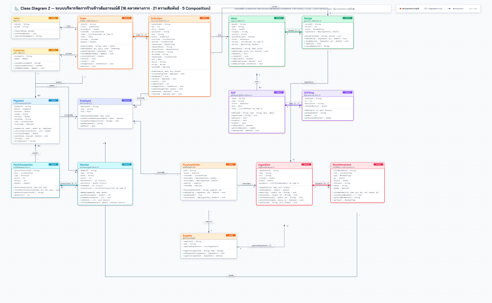

# 🍲 ร้านข้าวต้มอารมณ์ดี — Java OOP & OOAD Architecture
[](src/)
[](P9/Class-Diagram-2.svg)
[](docs/ARCHITECTURAL-ALIGNMENT-16CLASSES.md)
[-ea580c)](docs/CLASS-DIAGRAM-2-EXPLAINED.md)
[](src/Main.java)

โครงการออกแบบและพัฒนาระบบบริหารจัดการร้านอาหารตามมาตรฐาน SOP ด้วยการเขียนโปรแกรมเชิงวัตถุ (Object-Oriented Programming) ภาษา Java สอดคล้องตามกรอบกระบวนการวิเคราะห์และออกแบบระบบเชิงวัตถุ (**OOAD: P1–P9**) ครบถ้วนตามข้อกำหนด 1.1–1.5 ของหลักสูตร (น้ำหนัก 12.5%)

---

## 🌟 ผลงานสำคัญและส่งมอบล่าสุด (P8 & P9 Deliverables)

### 📐 1. Class Diagram 2 (Detailed Design — ข้อ 1.4 ของอาจารย์)
แผนภาพรวมระบบระดับ Detailed Design ครบทั้ง **16 คลาสทางการ** โดยแต่ละกล่องคลาสมีครบทั้ง 3 Compartments (ชื่อคลาส, Attributes พร้อม `- private` และประเภทข้อมูล, Operations พร้อม `+ public` และพารามิเตอร์) เชื่อมโยง **21 เส้นความสัมพันธ์** เน้น **5 Pure Composition (◆)** และ **1 Aggregation (◇)**

<p align="center">
  
</p>

* **[P9/Class-Diagram-2.png](P9/Class-Diagram-2.png)**: 📸 **ภาพความละเอียดสูงระดับ 4K Ultra-Res (4,300 × 2,650 px)** คมชัดทุกตัวแปร วางลง Canva สไลด์ 16:9 ได้เต็มแผ่น
* **[P9/Class-Diagram-2.svg](P9/Class-Diagram-2.svg)**: 📐 **ไฟล์เวกเตอร์ SVG** ขยายได้ไม่จำกัด คมชัด 100%
* **[P9/Class-Diagram-2-Viewer.html](P9/Class-Diagram-2-Viewer.html)**: 🔍 **เว็บแอป Interactive Viewer** สำหรับเปิดพรีเซนต์สด ลากเลื่อน (Pan), ซูมเข้า-ออก (Zoom), และมีปุ่มไฮไลต์เฉพาะ Composition 5 คู่แท้
* **[docs/CLASS-DIAGRAM-2-EXPLAINED.md](docs/CLASS-DIAGRAM-2-EXPLAINED.md)**: 📖 **คู่มือเจาะลึก Class Diagram 2 และแนวทางการตอบคำถามอาจารย์**
* **ภาพเจาะลึกรายหมวด 4 โซน (สำหรับวางสไลด์ Canva ทีละหน้า):**
  * 🛒 **โซน 1 (หน้าร้านและออเดอร์):** [P9/Class-Diagram-2-Part1-Orders.png](P9/Class-Diagram-2-Part1-Orders.png) (`Table`, `Customer`, `Order ◆ OrderItem`)
  * 🍳 **โซน 2 (ครัว สูตร และ SOP):** [P9/Class-Diagram-2-Part2-Kitchen.png](P9/Class-Diagram-2-Part2-Kitchen.png) (`Menu ◆ Recipe`, `SOP ◆ SOPStep`)
  * 📦 **โซน 3 (คลังวัตถุดิบและจัดซื้อ):** [P9/Class-Diagram-2-Part3-Stock.png](P9/Class-Diagram-2-Part3-Stock.png) (`Ingredient ◆ StockMovement`, `PurchaseOrder`, `Supplier`)
  * 💳 **โซน 4 (แคชเชียร์และแต้มสมาชิก):** [P9/Class-Diagram-2-Part4-Cashier.png](P9/Class-Diagram-2-Part4-Cashier.png) (`Payment`, `Member ◆ PointTransaction`, `Employee`)

---

### 📚 2. บทวิเคราะห์เปรียบเทียบโค้ดกับตำรา Deitel ATM Case Study บทที่ 13
* **[docs/CODE-COMPARISON-DEITEL-CH13.md](docs/CODE-COMPARISON-DEITEL-CH13.md)**: 🏛️ **การเปรียบเทียบเชิงลึกจุดต่อจุดกับตำรา *Java How to Program, 8/e* Chapter 13**
  * กฎ 4 ข้อในการแปลงกล่องคลาสสู่ Java (Section 13.2 Four Guidelines)
  * ทิศทางของลูกศร (Navigability) สู่การประกาศ Reference Fields
  * การเขียน Composition (◆) ใน Java และวงจรชีวิต (Lifecycle Binding / Cascade Destruction)
  * ข้อแก้ต่าง Section 13.5 (Incomplete Design): ทำไมในโค้ดถึงมี Helper Methods เพิ่มเติมจากไดอะแกรมตั้งต้น

---

### 🎙️ 3. สคริปต์นำเสนอพร้อมการ์ดสไลด์จริง (Presenter Cue-Cards)
* **[P9-PRESENTATION-SCRIPT.pdf](P9-PRESENTATION-SCRIPT.pdf)**: 📑 **สคริปต์พูดนำเสนอ P9 แบบมีการ์ดภาพสไลด์จริง (PDF 21 หน้า)**
  * ภาพแคปเจอร์สไลด์จริง 19 หน้า พร้อมจุดชี้จอ (Visual Cues) และสคริปต์สั้นกระชับ (2–4 บรรทัดต่อสไลด์)
  * อ้างอิงทฤษฎีตามมาตรฐานสากล: **OMG UML 2.5.1 Section 11.2.3**, **Oracle Java Tutorials**, **Deitel & Deitel ATM Case Study**, และ **Craig Larman**
  * คลังคำถาม-คำตอบปราบเซียนสำหรับป้องกันตัวในการสอบสด 1 ชั่วโมง
* **[P9-PRESENTATION-SCRIPT.html](P9-PRESENTATION-SCRIPT.html)**: ฉบับเว็บแอปสำหรับเปิดซ้อมพูดบนเบราว์เซอร์

---

## 💎 สรุป Pure Composition 5 คู่แท้ในระบบ (Solid Diamond ◆)

ทุกคู่เป็น **Strong Aggregate / Pure Composition** ตามนิยามของ **OMG UML 2.5.1** โดยคลาส Part มีวงจรชีวิตผูกพันกับคลาส Whole และตายตาม Whole เสมอ:

| ลำดับ | Whole (เจ้าของสิทธิ์ ◆) | Part (ส่วนประกอบย่อย) | Multiplicity | การควบคุมในโค้ด Java (`src/model/`) |
|:---:|---|---|:---:|---|
| **①** | **Order** (คำสั่งซื้อ) | **OrderItem** (รายการอาหาร) | `1` : `1..*` | `Order.addItem()` เป็นผู้ `new OrderItem()` ภายใน และเมื่อเรียก `Order.destroy()` จะเรียก `item.destroy()` ทุกรายการพร้อมกัน |
| **②** | **Menu** (เมนูอาหาร) | **Recipe** (สูตรอาหาร BOM) | `1` : `1..*` | สูตรอาหารเวอร์ชันนั้นผูกติดกับเมนูเฉพาะ ไม่สามารถนำสูตรลอยๆ ไปใช้นอกเมนูได้ |
| **③** | **SOP** (คู่มือปฏิบัติงาน) | **SOPStep** (ขั้นตอนย่อย) | `1` : `1..*` | ขั้นตอนย่อยถูกสร้างขึ้นเพื่ออธิบาย SOP ของเมนูนั้นเท่านั้น ไม่สามารถดำรงอยู่นอกคู่มือได้ |
| **④** | **Ingredient** (วัตถุดิบ) | **StockMovement** (ประวัติสต็อก) | `1` : `0..*` | บันทึก Audit Log ทุกครั้งที่ตัดของ/รับของ/ปรับยอด เกิดจากวัตถุดิบนั้นและตัดขาดจากกันไม่ได้ |
| **⑤** | **Member** (สมาชิก) | **PointTransaction** (ประวัติแต้ม) | `1` : `0..*` | ประวัติการได้แต้ม/แลกแต้ม ผูกติดกับบัญชีสมาชิกคนนั้นตลอดอายุการใช้งาน |

---

## 🏗️ โครงสร้างโปรเจกต์ (Project Structure)

```text
├── src/
│   ├── Main.java                        # Driver Class & Text Mode Simulator (FR1–FR8)
│   └── model/                           # 16 Official Domain Model Classes
│       ├── Customer.java                # ลูกค้า (Entity เชื่อม Member)
│       ├── Employee.java                # พนักงานและบทบาท (Manager, Cashier, Cook)
│       ├── Ingredient.java              # [Whole ④] วัตถุดิบในคลัง
│       ├── Member.java                  # [Whole ⑤] สมาชิกและกฎคำนวณแต้ม
│       ├── Menu.java                    # [Whole ②] เมนูอาหารและตัวเลือก
│       ├── Order.java                   # [Whole ①] คำสั่งซื้อ / บิลโต๊ะ
│       ├── OrderItem.java               # [Part ①] รายการอาหารในบิล
│       ├── Payment.java                 # การชำระเงินและออกใบเสร็จ
│       ├── PointTransaction.java        # [Part ⑤] ประวัติแต้มสะสม
│       ├── PurchaseOrder.java           # ใบสั่งซื้อวัตถุดิบ (PO)
│       ├── Recipe.java                  # [Part ②] สูตรอาหาร / BOM
│       ├── SOP.java                     # [Whole ③] คู่มือปฏิบัติงานมาตรฐาน
│       ├── SOPStep.java                 # [Part ③] ขั้นตอนย่อย SOP
│       ├── StockMovement.java           # [Part ④] บันทึก Audit Log สต็อก
│       ├── Supplier.java                # ผู้จัดจำหน่ายวัตถุดิบ (◇ Aggregation)
│       └── Table.java                   # โต๊ะอาหารและรหัส QR
├── P9/
│   ├── Class-Diagram-2.png              # ภาพ Class Diagram 2 ความละเอียด 4K (4300x2650)
│   ├── Class-Diagram-2.svg              # เวกเตอร์ SVG คมชัด 100%
│   ├── Class-Diagram-2-Viewer.html      # เว็บแอป Interactive Pan/Zoom Viewer
│   ├── Class-Diagram-2-Part1-Orders.png # ภาพเจาะลึก โซน 1 หน้าร้านและออเดอร์
│   ├── Class-Diagram-2-Part2-Kitchen.png# ภาพเจาะลึก โซน 2 ครัวและสูตรอาหาร
│   ├── Class-Diagram-2-Part3-Stock.png  # ภาพเจาะลึก โซน 3 คลังและจัดซื้อ
│   ├── Class-Diagram-2-Part4-Cashier.png# ภาพเจาะลึก โซน 4 แคชเชียร์และสมาชิก
│   ├── P9-THEORY.html                   # หน้าเว็บอธิบายทฤษฎี Composition ฉบับสรุป
│   └── slides_img/                      # ภาพแคปเจอร์สไลด์จริงจาก Canva (19 สไลด์)
├── docs/
│   ├── CLASS-DIAGRAM-2-EXPLAINED.md     # คู่มือ Class Diagram 2 และการตอบคำถาม
│   ├── CODE-COMPARISON-DEITEL-CH13.md   # บทวิเคราะห์เทียบเคียง Deitel ATM Ch.13
│   ├── ARCHITECTURAL-ALIGNMENT-16CLASSES.md # สรุปการปรับเทียบสถาปัตยกรรม 16 คลาส
│   ├── EXPLAIN-PROGRAM-STEP-BY-STEP.md  # อธิบายการทำงานโค้ดทีละสเต็ป
│   ├── HOW-TO-EXPLAIN.md                # สรุปย่อสำหรับทบทวนก่อนขึ้นพูด
│   └── P7-CODE-ALIGNMENT.md             # ตารางเทียบเคียงโค้ดกับ P7
├── examples/                            # ตัวอย่าง Input/Output ตามสไลด์ P4
├── tests/                               # ชุดทดสอบอัตโนมัติ (Python + Java)
├── P9-PRESENTATION-SCRIPT.pdf           # สคริปต์พูดนำเสนอแบบการ์ดภาพสไลด์จริง (PDF)
├── P9-PRESENTATION-SCRIPT.html          # สคริปต์พูดนำเสนอฉบับเปิดผ่านบราวเซอร์
├── run.sh                               # เชลล์สคริปต์รันโปรแกรมบน Linux / macOS
└── run.bat                              # แบทช์ไฟล์รันโปรแกรมบน Windows
```

---

## 🚀 วิธีการคอมไพล์และรันโปรแกรม (Execution Guide)

### ความต้องการพื้นฐาน
* ติดตั้ง **JDK 17** ขึ้นไป (รองรับ JDK 17, 21, 23)

### การรันบน Linux / macOS
```bash
bash run.sh
```

### การรันบน Windows
ดับเบิลคลิกไฟล์ `run.bat` หรือเปิด PowerShell / Command Prompt:
```cmd
run.bat
```

### การคอมไพล์และรันด้วยคำสั่งมาตรฐาน (Manual Run)
```bash
mkdir -p bin
javac -encoding UTF-8 -d bin src/model/*.java src/Main.java
java -Dfile.encoding=UTF-8 -cp bin Main
```

---

## 📋 เมนูทั้ง 8 ฟังก์ชันงาน (Text Mode Simulator FR1–FR8)

| หมายเลข | เมธอดใน Main | รายละเอียดการทำงานจำลองตาม Use Case |
|:---:|---|---|
| **1** | `uc01()` | **สั่งอาหาร (FR1):** สแกน QR โต๊ะจำลอง, ผูกสมาชิก, เลือกเมนูและระดับเผ็ด, Two-Pass Stock Check, ยืนยันออเดอร์, ติดตามสถานะ, และยื่นคำขอแก้ไข/ยกเลิก |
| **2** | `uc02()` | **จัดการ SOP (FR2):** สร้าง/แก้ไขคู่มือ SOP, กำหนดขั้นตอนย่อยและเวลานาทีมาตรฐาน, เผยแพร่, และปิดการใช้งาน |
| **3** | `uc03()` | **ระบบครัว KDS (FR3):** เลือกสถานีครัว (ครัวร้อน/ครัวเย็น/เครื่องดื่ม), ดึงคิวปรุง, เริ่มทำ, บันทึกเวลาแล้วเทียบเวลาจริงกับ SOP, และกดพร้อมเสิร์ฟ |
| **4** | `uc04()` | **ชำระเงิน (FR4):** ค้นหาบิลโต๊ะ, คำนวณส่วนลดจากการแลกแต้ม, รับเงินสด/QR จำลอง, ตัดแต้ม, สะสมแต้มใหม่, และพิมพ์ใบเสร็จรับเงิน |
| **5** | `uc05()` | **คลังวัตถุดิบ (FR5):** ตรวจสอบสต็อกต่ำกว่าเกณฑ์ขั้นต่ำ (Min Qty), ออกใบสั่งซื้อ PO, ตรวจรับของเข้าคลัง, ปรับยอดสต็อก, และดูประวัติ Audit Log |
| **6** | `uc06()` | **รายงานสถิติ (FR6):** สรุปยอดขายประจำวัน, ยอดตามช่วงเวลา, อันดับเมนูขายดี/ขายช้า, และประสิทธิภาพเวลาครัวเทียบ SOP |
| **7** | `uc07()` | **จัดการเมนูและสูตร (FR7):** เพิ่มเมนูใหม่, จัดการสูตรอาหาร (Recipe BOM) หลายเวอร์ชัน, กำหนดตัวเลือกเสริม (Options), และเปิด/ปิดการขาย |
| **8** | `uc08()` | **สมาชิกและคำขอ (FR8):** สมัครสมาชิกใหม่, ตรวจสอบแต้ม, กำหนดกฎการสะสม/แลกแต้มกลางของร้าน, และผู้จัดการพิจารณาอนุมัติคำขออาหาร |

---

## 🧪 การทดสอบระบบ (Automated Tests)

โปรเจกต์มีชุดทดสอบอัตโนมัติเพื่อตรวจสอบความถูกต้องของกฎทางธุรกิจ (Business Rules) ทั้งหมด:
```bash
python3 tests/run_tests.py
```
* ตรวจสอบกฎการตัดสต็อกวัตถุดิบแบบ Two-Pass Stock Check (ป้องกันสต็อกติดลบ)
* ตรวจสอบความถูกต้องของการคำนวณเงิน ส่วนลด และแต้มสะสม
* ตรวจสอบความสัมพันธ์ Composition ทั้ง 5 คู่ และการทำลายตามแบบ Cascade Destruction
* ทดสอบการป้อนข้อมูลจำลองครบทั้ง 8 Use Cases โดยไม่มี Error
